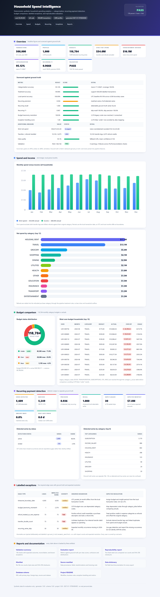

# Household Spend Intelligence

A deterministic, synthetic analytics platform for categorizing transactions, mapping recurring payments, and comparing household spending against monthly budgets.

The build covers the complete workflow from the problem statement: master data, dependent transaction and event records, category taxonomy and rules, monthly budgets, injected recurring series, labelled exception cases, derived insights, validation, evaluation, and fixed-seed reproducibility.



*The dashboard above is `dataset/dashboard.html` — a self-contained file with no server or network dependency. GitHub shows HTML as source, so after cloning run `python -m src.cli dashboard --dataset dataset` (or open the committed file) to view it interactively.*

## Quick start

Requires Python 3.11+ for `zoneinfo`, pandas, and numpy.

```powershell
python -m pip install -r requirements.txt

# Starter: 100 profiles / 50,000 transactions
python -m src.cli all --scale starter --seed 20261022 --out dataset

# Full required volume: 1,000 profiles / 500,000 transactions
python -m src.cli all --scale full --seed 20261022 --out dataset --formats csv,json,sql
```

Other commands:

```powershell
python -m src.cli generate --scale full --seed 20261022 --out dataset
python -m src.cli validate --dataset dataset
python -m src.cli evaluate --dataset dataset
python -m src.cli dashboard --dataset dataset
python -m src.cli reproduce --scale full --seed 20261022 --formats csv --out dataset
```

The fixed seed is `20261022`. `mini`, `starter`, and `full` scales all use the same generator, with scale passed only as a volume parameter. `all` runs generate, validate, evaluate, and the dashboard in one shot.

## Tests

```powershell
python -m pip install -r requirements.txt
python -m pytest
```

24 tests in two suites, running in seconds on a freshly generated `mini` dataset (seed `20261022`) — a clean checkout needs no pre-built data:

| Suite | Covers |
|---|---|
| `tests/test_rules.py` | Unit tests: rule priority ordering, merchant alias matching, inactive-rule exclusion, unmatched fallbacks, sign-based income fallback, sequential `RUL-` IDs, legacy taxonomy alias resolution, classification-metric math |
| `tests/test_pipeline.py` | End-to-end: scale volumes, ID conventions (`USR-`/`ACC-`/`TXN-`/`BUD-`/`REC-`), primary-key uniqueness, foreign-key joins, date ranges, signed amounts and treatment enums, validation PASS, all five labelled edge cases, ground-truth isolation from pipeline features, derived budget arithmetic, evaluation metric bounds, same-seed checksum determinism |

## What is produced

| Area | Output |
|---|---|
| Entity data | `dataset/data/*.csv` |
| JSON exports | `dataset/data/json/` |
| SQLite-compatible SQL | `dataset/data/sql/schema.sql`, `seed.sql`, `seed_ground_truth.sql` |
| Ground truth | `dataset/ground_truth/` |
| Analytics outputs | `dataset/outputs/` |
| Manifest and provenance | `dataset/metadata/manifest.json`, `source_manifest.json` |
| Validation | `dataset/validation/validation_summary.json`, `.md` |
| Evaluation | `dataset/outputs/evaluation_report.json`, `.md` |
| Reproducibility | `dataset/outputs/reproducibility_report.json`, `.md` |
| Dashboard | `dataset/dashboard.html` (self-contained static page, no server or network needed) |
| Row samples | `samples/*.csv` (500-row excerpts so reviewers can inspect real records without pulling 483 MB) |

Every file written by the generator has a row count, byte size, and SHA-256 checksum in the manifest. Validation, evaluation, reproducibility, and dashboard outputs are written after generation and are not part of that checksum set.

> **Note on repository size:** the bulk exports under `dataset/data/` plus large CSV/JSONL ground-truth files are excluded from git (483 MB total, with a 121 MB SQL file that exceeds GitHub's 100 MB limit). They are fully reproducible with `python -m src.cli all --scale full --seed 20261022 --out dataset --formats csv,json,sql` in ~4 minutes. The committed evidence — reports, manifest, dashboard, and `samples/` — reflects that exact run.

## Actor workflows

| Actor | Primary outputs |
|---|---|
| Customer / account holder | `dashboard.html`, `monthly_spend.csv`, `insight.csv`, budget status and net-savings views |
| Operations analyst | `dashboard.html`, `categorization_decisions.csv`, `budget_comparison.csv`, `recurring_series.csv`, `evaluation_report.md` |
| Risk / compliance reviewer | `anomaly_manifest.csv`, lifecycle `entity_event.csv`, `validation_summary.md`, strict treatment evidence |
| System administrator | `manifest.json`, `source_manifest.json`, fixed seed, SQL/JSON seed exports, `reproducibility_report.md` |


## Entity model

| Entity | Role | Primary key | Key relationships |
|---|---|---|---|
| UserProfile | Household/customer master | `user_id` | 1:N Account, Budget, Transaction, RecurringSeries, Insight |
| Account | Checking, savings, credit card | `account_id` | N:1 UserProfile; 1:N Transaction |
| Merchant | Canonical merchant | `merchant_id` | 1:N MerchantAlias, Transaction; N:M Category through CategoryRule |
| Transaction | Signed ledger entry | `transaction_id` | N:1 UserProfile, Account, Merchant; self-refund link; N:M Transaction through TransferLink |
| Category | Taxonomy node | `category_code` | Self parent/child; 1:N Merchant defaults, CategoryRule, Budget |
| CategoryRule | Descriptor-to-category decision | `rule_id` | N:1 Category, Merchant |
| Budget | User/category/month allocation | `budget_id` | Bridge between UserProfile and Category with period and amount |
| RecurringSeries | Detected recurring payment series | `series_id` | N:1 UserProfile, Account, Merchant, Category |
| Insight | Derived monthly metric | `insight_id` | N:1 UserProfile |
| TransferLink | Bridge pair for internal transfers | `link_id` | N:M Transaction |
| TransactionCategoryDecision | Categorization decision history bridge | `decision_id` | N:M Transaction and Category with confidence and rule trace |
| EntityEvent | Lifecycle event history | `event_id` | Polymorphic reference to user/account entities |

Full field-level types, allowed values, units, uniqueness, and validation rules are in [docs/data_dictionary.md](docs/data_dictionary.md). Design decisions, exception handling, and metric formulas are in [docs/decisions.md](docs/decisions.md). The executable schema is [schema.sql](schema.sql); generated copies are in `dataset/data/sql/`.

### ID conventions

- `USR-000001`
- `ACC-USR-000001-01`
- `TXN-2026-00000001`
- `BUD-USR-000001-2026-01-GROCERY`
- `REC-000001`
- Supporting: `MER-000001`, `MAL-000001`, `CAT-000001`, `RUL-000001`, `TLK-000001`, `DCS-00000001`, `INS-000001`, `EVT-000001`, `ANM-000001`
- Ground truth series use separate `TRU-000001` IDs so detected and true series cannot be confused.

Counters are zero-padded. Transaction IDs are immutable sequential identifiers assigned after deterministic UTC-time sorting.

## Business rules

1. Master data is created before child data: categories, users, accounts, merchants, aliases, rules, then budgets, transactions, links, detected series, insights, and events.
2. Amounts are signed in USD: expenses and transfer debits negative; income, transfer credits, and refunds positive.
3. Transaction period assignment uses the local transaction date and the user's IANA timezone, not the UTC posting month.
4. Internal transfers are linked in `transfer_link`; both legs are excluded from spending. The labelled duplicate-transfer case is excluded as well.
5. Refunds are positive credits. Normal refunds carry a refund descriptor and link to the original; refunds offset the original category instead of counting as new spend.
6. Category labels are generated from the merchant's canonical category plus documented context, not random assignment. Category rules are a separate input and intentionally produce measurable errors on ambiguous descriptors.
7. Monthly budgets are derived from income band and category shares, independently of actual spending. Deprecated taxonomy codes are deliberately injected and must be resolved through `category_alias`.
8. Insights are derived from the strict ledger: net spend, net savings, budget variance, recurring series count, and data-quality rates.
9. History is retained: transactions are never overwritten, refunds and transfers are separate linked records, and lifecycle state changes are in `entity_event`.

## Labelled exceptions

| Issue type | Data behaviour | Expected handling |
|---|---|---|
| `transfer_double_count` | Unlinked duplicate of a transfer debit appears as spending | Exclude all transfer legs and linked duplicates from spend |
| `refund_treated_as_new_expense` | Positive refund credit with purchase-like descriptor and often no original link | Treat positive credits in expense categories as refunds and offset spend |
| `recurring_series_skip` | One expected monthly occurrence is missing | Detect the gap and report the missing occurrence; do not silently shift the series |
| `timezone_boundary_date` | Local month differs from UTC posting month | Assign budget and insight periods from local transaction date |
| `budget_taxonomy_mismatch` | Budget uses a deprecated category code | Resolve through `category_alias` before comparing to actuals |

All exceptions have transaction-level, series-level, or budget-level ground truth plus an anomaly manifest with expected resolution. Ground truth is never joined into pipeline features.

## Analytics pipeline

- **Categorization:** priority-ranked descriptor rules with source rule, confidence, and decision source. The pipeline does not see ground truth.
- **Strict treatment:** transfers excluded, refunds offset, income kept separate, local-date period assignment.
- **Recurring detection:** groups by user, merchant, and direction; requires at least three monthly gaps of 25-35 days and amount coefficient of variation at most 0.22. Detects missed occurrences from gaps over 45 days.
- **Budget comparison:** resolves legacy budget codes, aggregates actual spend by predicted category, calculates variance, usage, and under/near/over status.
- **Insights:** monthly spend, net savings, budget variance, recurring counts, and data-quality rates, with formula version and source row counts.

## Evaluation

The evaluation joins outputs to ground truth only after the pipeline runs. It reports:

- Categorization accuracy, macro F1, weighted F1, per-class metrics, top confusions, fallback and uncategorized rates.
- Treatment accuracy for spend, income, transfer, and refund.
- Local-month versus UTC-month period accuracy.
- Transfer/refund spend impact and naive overstatement.
- Recurring series precision, recall, F1, amount error, next-date error, skip recall, and posted-occurrence support.
- Budget resolution accuracy, status distribution, and the impact of naive taxonomy joins.
- Ledger/account/monthly-spend reconciliation.
- Exception handling score across all five required edge cases.
- Volume, amount, category, and monthly distributions for realism review.

Latest results are in `dataset/outputs/evaluation_report.md`.

## Full-scale results

Generated with seed `20261022` at the required volume:

| Measure | Result |
|---|---:|
| User profiles | 1,000 |
| Transactions | 500,000 |
| Accounts | 2,335 |
| Budgets | 118,784 |
| Detected recurring series | 5,609 |
| Insights | 59,185 |
| Validation | 138 pass, 0 warn, 0 fail |
| Reproducibility | 25/25 files match by row count and SHA-256 |
| Categorization accuracy | 95.12% |
| Categorization macro F1 | 0.9647 |
| Treatment accuracy | 99.96% |
| Recurring precision / recall / F1 | 93.58% / 100.00% / 0.9668 |
| Recurring skip recall | 100.00% |
| Local-period accuracy | 100.00% (UTC baseline 99.10%) |
| Budget taxonomy resolution | 100.00% |
| Exception handling score | 1.0000 |
| Strict net spend | $54,015,523.30 |
| Naive overstatement avoided | $16,122,233.08 |

Labelled exception impact counts:

| Issue type | Count |
|---|---:|
| transfer_double_count | 75 |
| refund_treated_as_new_expense | 75 |
| recurring_series_skip | 30 |
| timezone_boundary_date | 4,505 |
| budget_taxonomy_mismatch | 2,376 |

One additional UTC/local boundary transaction carries a primary refund-anomaly label, so all boundary rows are labelled without overwriting the primary issue. Detailed reports are in `dataset/validation/validation_summary.md`, `dataset/outputs/evaluation_report.md`, and `dataset/outputs/reproducibility_report.md`.

## Validation

Validation independently checks primary keys, foreign keys, enums, ID conventions, date ordering, account lifecycle, refund and transfer arithmetic, budget period alignment, balance reconciliation, decision coverage, budget and insight reconciliation, manifest checksums, ground-truth coverage, duplicate fingerprints, annual month coverage, and labelled exception coverage.

See `dataset/validation/validation_summary.md` and `.json`.

## Reproducibility

`python -m src.cli reproduce --scale full --seed 20261022 --formats csv --out dataset` performs two fresh generations and compares every CSV file by row count and SHA-256. The full run matched 25/25 files. An all-format mini run matched 47/47 files, covering CSV, JSON, JSONL.GZ, and SQL. The report is written to `dataset/outputs/reproducibility_report.md`. Timestamps are fixed to `2027-01-15T00:00:00Z`; JSON gzip streams use a fixed mtime of zero, so checksums are stable across runs.

## Lawful provenance

No external data is used. All names, households, accounts, merchants, descriptors, and transactions are synthetic. Emails use `example.test`. No personal, confidential, scraped, or access-controlled information is included. Public schema conventions only inspired field names. `dataset/metadata/source_manifest.json` records provenance, library versions, and the absence of external sources.

## Assumptions and limitations

- Twelve-month horizon is calendar year 2026.
- Merchant categories are synthetic and simplified; MCC values are illustrative.
- Recurring detection is intentionally a baseline detector, not a production ML model.
- Budget shares are generic household planning assumptions, not financial advice.
- Category rules are a deliberately simple baseline so evaluation errors remain measurable.
- The SQL seed uses SQLite-compatible DDL and deferred foreign keys.
- The generated dataset is synthetic and must not be represented as real customer data.
